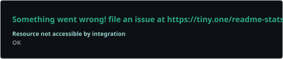

  

###

<h1 data-importer="text" align="left">Hi 👋 I'm Sandakelum Sameera Bandara?</h1>

###

###

<h2 data-importer="text" align="left">Aspiring Software Engineer | Full-Stack Development Enthusiast</h2>

###

✨ A Computer Science graduate passionate about software development. 🎓 BSc General Graduate from the University of Peradeniya (2025). 💻 Interested in building scalable and user-friendly web applications. 🚀 Currently developing Printoura, a full-stack printing and product ordering platform. 🌱 Continuously learning React, TypeScript, Node.js, Express.js and PostgreSQL. 🎯 Goal: Become a skilled Software Engineer and build impactful software solutions.

###

<h2 data-importer="text" align="left">Skills</h2>

###

  
  
  
  
  
  
  
  
  
  
  
  
  
  
  
  
  
  
  
  
  
  
  
  
  
  
  

###

 

  
  

###

  

###

  

